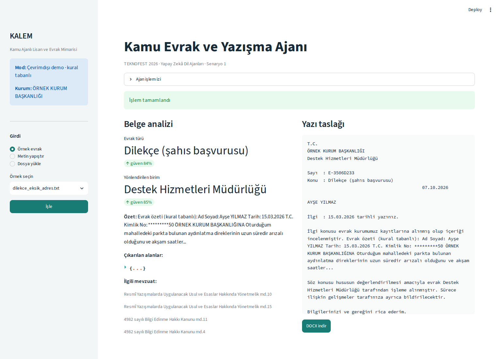
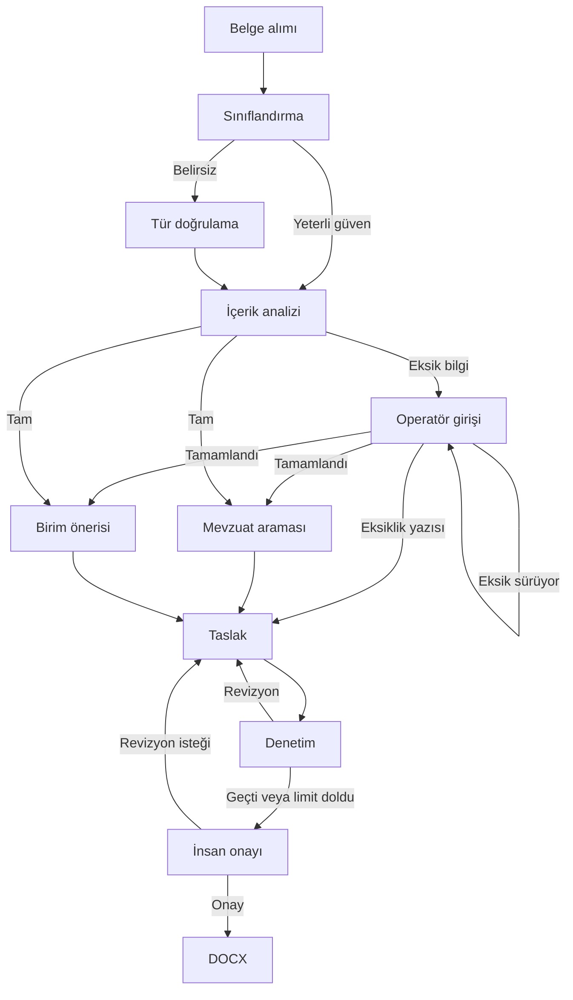

# KALEM

**Kamu Ajanlı Lisan ve Evrak Mimarisi** · TEKNOFEST 2026 Yapay Zekâ Dil Ajanları, Senaryo 1

Kamuya gelen bir evrakın türünü, içeriğini ve eksik bilgilerini inceleyen; ilgili birimi önerip yazı taslağı hazırlayan Python projesi. Amaç, belgeyi okuma ve ilk taslağı hazırlama işini bir akışta toplamak. Belirsiz sınıflandırmalarda, eksik bilgilerde ve son onayda kullanıcı devreye giriyor.

*Human-in-the-loop document analysis and drafting with LangGraph, local retrieval and a Streamlit interface.*

[Kurulum](#kurulum) · [Demo](docs/demo.md) · [Teknik notlar](docs/teknik-notlar.md) · [Değerlendirme](eval/rapor.md)



## Neler yapıyor?

- Evrakı sınıflandırıyor; kişi, kurum, tarih, konu ve talep gibi alanları çıkarıyor.
- YAML kurallarına göre zorunlu alanları kontrol ediyor. Eksikler tamamlanabiliyor veya eksiklik bildirim yazısı hazırlanabiliyor.
- Yerel örnek mevzuat korpusunda BM25 araması yapıyor ve birim kataloğundan yönlendirme öneriyor.
- Jinja2 şablonuyla yazı taslağı oluşturuyor; temel biçim ve kaynak atfı kontrollerinden geçiriyor.
- İşlem adımlarını arayüzde gösteriyor ve kullanıcı onayından sonra DOCX çıktısı veriyor.

**API anahtarı olmadan denenebilir.** Çevrimdışı modda anahtar kelimeler, düzenli ifadeler ve şablonlar kullanılıyor. LLM modu Groq veya LiteLLM üzerinden ayrıca etkinleştirilebiliyor.

## Kurulum

Python **3.12** önerilir (proje Python 3.11 ve üzerini hedefler). Komutları `app.py` ve `README.md` bulunan proje klasöründe çalıştırın.

```bash
python -m venv .venv
```

Sanal ortamı etkinleştirin:

| Ortam | Komut |
|---|---|
| Windows PowerShell | `.venv\Scripts\Activate.ps1` |
| Windows Komut İstemi | `.venv\Scripts\activate.bat` |
| macOS / Linux | `source .venv/bin/activate` |

```bash
python -m pip install -r requirements.txt
python scripts/index_corpus.py --bm25
```

`.env.example` dosyasını aynı klasörde `.env` adıyla kopyalayın. Varsayılan `KALEM_OFFLINE=1` ayarı API çağrısı yapmaz.

```bash
python -m streamlit run app.py
```

Arayüz: [localhost:8501](http://localhost:8501).

**İlk deneme:** `dilekce_eksik_adres.txt` örneğini seçin. Adres eksikliğini tamamlayın, taslağı inceleyip onaylayın ve DOCX dosyasını indirin. Alternatif olarak eksiklik bildirim yazısı oluşturabilirsiniz.

Terminalden aynı akışı denemek için:

```bash
python scripts/demo_cli.py data/ornek_evraklar/dilekce_eksik_adres.txt --offline --otomatik
```

`--otomatik`, eksikleri demo değerleriyle doldurur ve onayları otomatik verir. Kullanıcının karar verdiği akışı görmek için bu seçeneği kaldırın. Çıktılar `cikti/` klasörüne yazılır.

## Akış



LangGraph, ortak bir `EvrakState` üzerinde koşullu geçişleri ve onay noktalarını yönetiyor. Mevzuat araması ve birim önerisi paralel çalışıyor. Pydantic modelleri ajan yanıtlarının biçimini doğruluyor. Ayrıntılar: [teknik notlar](docs/teknik-notlar.md).

## Testler ve değerlendirme

```bash
python -m pip install -r requirements-dev.txt
python -m pytest -q
python -m ruff check .
python eval/run_eval.py --offline
```

Testler belge okuma güveni, maskeleme, metin parçalama, eksik alan kontrolü, arama, onay akışı ve Streamlit üzerinden DOCX üretimini kapsar. [GitHub Actions](.github/workflows/tests.yml) her push ve pull request için çevrimdışı testleri çalıştıracak şekilde tanımlıdır.

`data/golden_set/` içinde 17 sentetik belge ve beklenen etiketleri bulunur. Son çevrimdışı çalıştırmada sınıflandırma 17/17, etiketli birim yönlendirmesi 14/14, kritik eksik alan F1 değeri 1.000 çıktı. Bu küçük küme demo kurallarıyla aynı şablonları paylaşır; bağımsız bir başarı ölçümü değildir. LLM ve OCR başarımı bu sonuçlardan çıkarılamaz. [Belge bazındaki rapor](eval/rapor.md).

## Kapsam ve sınırlar

Bu sürüm bir yarışma prototipidir. Metin dosyaları ve metin katmanı olan PDF'ler temel girişlerdir. Görüntü OCR, multimodal okuma ve dense arama isteğe bağlıdır; burada doğrulanan demo bunlara ihtiyaç duymaz.

Mevzuat dosyaları örnek/özet metinlerdir. Üretilen yazılar resmî işlem yapmaz; uygunluk ve içerik kontrolü kullanıcıya aittir. Maskeleme yalnızca belirli T.C. kimlik numarası ve e-posta desenlerini kapsar; tam anonimleştirme sağlamaz. Gerçek belgelerle çevrimiçi kullanımda belge içeriği seçilen API sağlayıcısına gönderilir.

Geliştirmeye açık başlıca konular: daha çeşitli ve bağımsız bir test kümesi, gerçek LLM karşılaştırmaları, kalıcı işlem kaydı ve taranmış PDF desteği. [Çevrimiçi kurulum ve diğer sınırlar](docs/teknik-notlar.md).

## Kodda nereden başlanır?

| Dosya / klasör | İçerik |
|---|---|
| [`kalem/graph.py`](kalem/graph.py) | Akış, koşullu geçişler ve insan onayı |
| [`kalem/agents/`](kalem/agents/) | Sınıflandırma, analiz, mevzuat, yönlendirme, taslak ve denetim |
| [`kalem/llm/`](kalem/llm/) | API istemcisi, önbellek ve çevrimdışı kurallar |
| [`kalem/rag/`](kalem/rag/) | Madde bazlı parçalama, indeksleme ve arama |
| [`config/`](config/) | Evrak türleri, zorunlu alanlar, birim kataloğu ve ayarlar |
| [`app.py`](app.py) | Streamlit arayüzü |
| [`tests/`](tests/) | Birim, akış ve arayüz testleri |
| [`data/`](data/README.md) | Sentetik örnekler ve korpus açıklaması |

## Lisans

[MIT](LICENSE). Mevcut KALEM Takımı telif bildirimi korunmuştur.
