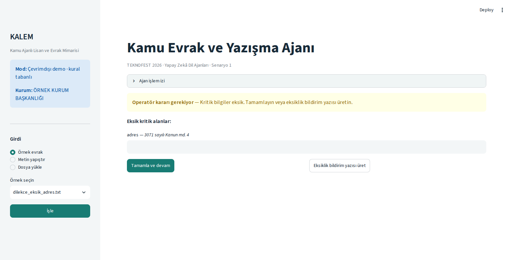

# Demoyu denemek

README'deki kurulumu tamamlayıp `python -m streamlit run app.py` komutunu çalıştırın. Aşağıdaki akış API anahtarı gerektirmez.

## Adresi eksik başvuru

1. Soldan **Örnek evrak** kaynağını ve `dilekce_eksik_adres.txt` dosyasını seçin.
2. **İşle** düğmesine basın. Sistem adres alanının eksik olduğunu gösterir.
3. Boş şekilde **Tamamla ve devam** derseniz işlem ilerlemez. Örnek bir adres girin: `Örnek Mahallesi No: 1, Merkez`.
4. **Tamamla ve devam** ile taslak onayına geçin. Taslağı okuyun, gerekirse değiştirin ve **Onayla** düğmesine basın.
5. Sonuç ekranındaki **DOCX indir** düğmesiyle dosyayı alın.



Adres girmek yerine **Eksiklik bildirim yazısı üret** seçeneğini de deneyebilirsiniz. Bu dal, normal cevap taslağı yerine başvurunun eksiklerini belirten bir metin oluşturur.

## Sonuç ekranı

Eksik bilgisi tamamlanan belge için analiz ve taslak birlikte gösterilir. Eksik bilgi adımını atlayan örneği görmek isterseniz `dilekce_tam.txt` doğrudan taslak onayına ilerler. Sınıflandırma, birim önerisi ve kullanılan örnek kaynaklar sonuç ekranında görülebilir.


Ekran görüntüleri sentetik örneklerle çalışan çevrimdışı uygulamadan alınmıştır. LLM çıktısı göstermez. Aynı modda üretilen [örnek taslak metni](examples/taslak.txt) ve [analiz özeti](examples/analiz.json) de incelenebilir. Tarih ve işlem numarası her çalıştırmada değişir.

## Terminalden

```bash
python scripts/index_corpus.py --bm25
python scripts/demo_cli.py data/ornek_evraklar/dilekce_tam.txt --offline --otomatik
```

Otomatik demo kullanıcı onayını beklemez. Etkileşimli kullanım için `--otomatik` seçeneğini kaldırın.
